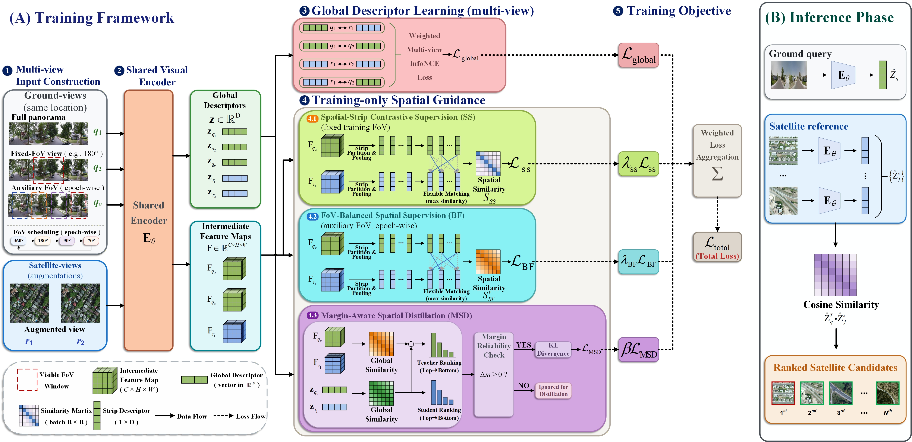

# RAGeo: Residual-aware Global Representation Learning for Robust Cross-View Geo-Localization

**Official PyTorch implementation of RAGeo, published in ISPRS Journal of Photogrammetry and Remote Sensing.**

**Youyuan Xue, Fan Guo, Jiahua Zou, Jin Tang, Zhihu Wu**

[](https://doi.org/10.1016/j.isprsjprs.2026.10.033)


**Paper:** https://doi.org/10.1016/j.isprsjprs.2026.10.033

---

## Overview

Cross-view geo-localization (CVGL) aims to retrieve the geographically corresponding satellite image for a ground-level query. While global-descriptor retrieval enables efficient large-scale matching, its performance can deteriorate considerably under unknown orientations and restricted fields of view (FoVs).

In this work, we investigate whether intermediate visual features retain useful spatial correspondence evidence that is not fully captured by the final global descriptor.

We propose **RAGeo**, a residual-aware global representation learning framework that integrates reliable spatial evidence into compact global representations during training.

RAGeo combines three complementary components:

- **Spatial-Strip Contrastive Supervision (SS):** Learning spatial correspondence across different visibility conditions.
- **FoV-Balanced Spatial Supervision (BF):** Strengthening spatial representation learning under restricted fields of view.
- **Margin-Aware Spatial Distillation (MSD):** Transferring useful spatial evidence into the global descriptor while accounting for retrieval margins.

At inference time, RAGeo retains the original global-descriptor retrieval pipeline without requiring feature-map storage, local matching, or top-K reranking.

## Framework



## Requirements

The implementation is based on PyTorch and uses a ConvNeXt-Base visual backbone.

Install the required dependencies:

```bash
pip install -r requirements.txt
```

A CUDA-enabled GPU is recommended for training and large-scale evaluation.

## Project Structure

```text
RAGeo/
├── README.md
├── requirements.txt
├── train_cvusa.py
├── train_cvact.py
├── train_vigor.py
├── eval_cvusa.py
├── eval_cvact.py
├── eval_vigor.py
├── rageo/
│   ├── model.py
│   ├── loss.py
│   ├── transforms.py
│   ├── utils.py
│   ├── dataset/
│   │   ├── cvusa.py
│   │   ├── cvact.py
│   │   └── vigor.py
│   └── evaluate/
│       ├── cvusa_and_cvact.py
│       └── vigor.py
└── tools/
    ├── prepare_gps_cvusa.py
    ├── prepare_gps_cvact.py
    └── prepare_gps_vigor.py
```

## Datasets

RAGeo is evaluated on three widely used cross-view geo-localization benchmarks:

- **CVUSA**
- **CVACT**
- **VIGOR**

The experiments cover multiple FoV settings, unknown orientations, and both Same-Area and Cross-Area protocols for VIGOR.

Please obtain the datasets from their respective official sources and organize them according to the directory structures expected by the dataset loaders.

For convenience, the following directory layout can be used:

```text
datasets/
├── CVUSA/
├── CVACT/
└── VIGOR/
```

Alternatively, dataset locations can be specified using the `--data_folder` argument. The original dataset structures, split files, and metadata should be preserved.

### GPS Neighbor Preparation

The training pipeline uses GPS-based neighbor information for sample selection.

Utilities are provided to construct the required nearest-neighbor dictionaries for each dataset.

**CVUSA**

```bash
python -m tools.prepare_gps_cvusa \
    --data_folder ./datasets/CVUSA
```

**CVACT**

```bash
python -m tools.prepare_gps_cvact \
    --data_folder ./datasets/CVACT
```

**VIGOR**

```bash
python -m tools.prepare_gps_vigor \
    --data_folder ./datasets/VIGOR
```

The VIGOR preparation utility generates separate neighbor dictionaries for Same-Area and Cross-Area training.

These utilities follow the neighbor construction procedures used in the implementation. Ensure the generated dictionaries correspond to the training splits and dataset indexing conventions.

## Pretrained Backbone

RAGeo uses the following visual backbone:

```text
convnext_base.fb_in22k_ft_in1k_384
```

Before training, prepare the corresponding pretrained backbone weights in a compatible PyTorch checkpoint format.

The training scripts accept a local pretrained checkpoint through `--local_pretrain_path`.

For example:

```text
pretrained/
└── pytorch_model.bin
```

The backbone initialization checkpoint is distinct from a fully trained RAGeo checkpoint.

## Training

Training scripts are provided separately for CVUSA, CVACT, and VIGOR. The default configurations implement the corresponding RAGeo training pipelines.

### CVUSA

```bash
python train_cvusa.py \
    --data_folder ./datasets/CVUSA \
    --gps_dict_path ./datasets/CVUSA/gps_dict.pkl \
    --local_pretrain_path ./pretrained/pytorch_model.bin \
    --epochs 60
```

### CVACT

```bash
python train_cvact.py \
    --data_folder ./datasets/CVACT \
    --gps_dict_path ./datasets/CVACT/gps_dict.pkl \
    --local_pretrain_path ./pretrained/pytorch_model.bin \
    --epochs 60
```

### VIGOR

**Same-Area training**

```bash
python train_vigor.py \
    --data_folder ./datasets/VIGOR \
    --local_pretrain_path ./pretrained/pytorch_model.bin \
    --same_area 1 \
    --epochs 60
```

**Cross-Area training**

```bash
python train_vigor.py \
    --data_folder ./datasets/VIGOR \
    --local_pretrain_path ./pretrained/pytorch_model.bin \
    --same_area 0 \
    --epochs 60
```

VIGOR training automatically selects the corresponding GPS neighbor dictionary when `--gps_dict_path` is not explicitly specified.

Additional training options, including batch size, learning rate, FoV configuration, and loss weights, can be inspected using:

```bash
python train_cvusa.py --help
python train_cvact.py --help
python train_vigor.py --help
```

## Evaluation

Separate evaluation scripts are provided for the three benchmarks.

```text
eval_cvusa.py
eval_cvact.py
eval_vigor.py
```

The evaluation pipeline uses global visual descriptors for cross-view retrieval.

Supported configurations include different ground-view FoVs and dataset-specific evaluation protocols.

For CVUSA and CVACT, evaluation can be configured with a trained checkpoint, dataset directory, FoV, and random seed.

For VIGOR, the evaluation implementation supports Same-Area and Cross-Area protocols.

Available evaluation arguments can be inspected using:

```bash
python eval_cvusa.py --help
python eval_cvact.py --help
python eval_vigor.py --help
```

The evaluation protocol should match the desired dataset split, orientation setting, and FoV configuration.

## Reproducibility

The repository provides the main components required to reproduce the RAGeo methodology:

- RAGeo model and training objectives
- Dataset-specific training pipelines
- FoV-dependent data transformations
- GPS neighbor preparation utilities
- Cross-view retrieval evaluation scripts

The implementation supports configurable random seeds and training parameters.

Reproduction results may vary slightly depending on the random seed, software environment, hardware, and evaluation settings.

## Citation

If you find this work useful, please cite:

**Youyuan Xue, Fan Guo, Jiahua Zou, Jin Tang, and Zhihu Wu.**  
RAGeo: Residual-aware global representation learning for robust cross-view geo-localization.  
*ISPRS Journal of Photogrammetry and Remote Sensing*, 2026.

DOI: https://doi.org/10.1016/j.isprsjprs.2026.10.033

## Acknowledgments

This work was supported by the Scientific Research Project of Xiang Jiang Lab (No. 23XJ02002) and the Natural Science Foundation of Hunan Province of China (No. 2025JJ50396).

Computing resources were provided in part by the High Performance Computing Center of Central South University.
